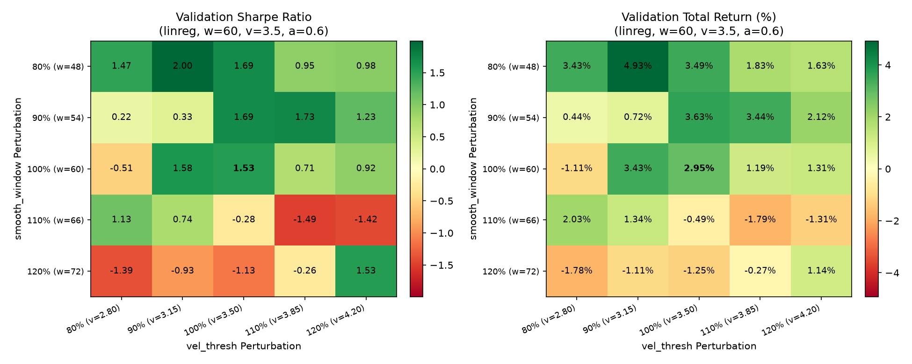
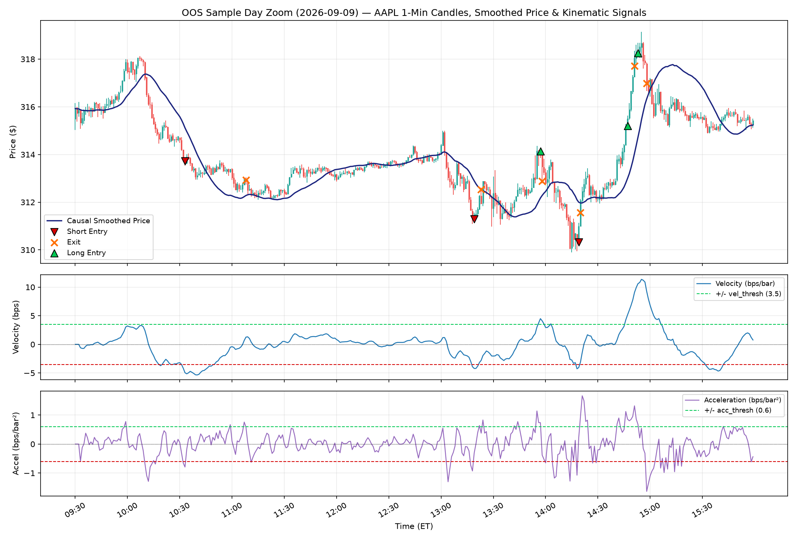
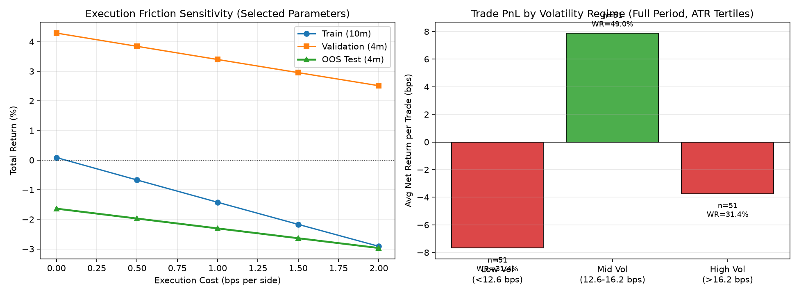

# AAPL 1-Minute Kinematic (Velocity & Acceleration) Strategy — Backtest Report

## 1. Executive Summary & Verdict
**Verdict:** **No Durable Positive Edge at 1-Minute Granularity After Realistic Friction**

- **Dataset:** 1.5 years of split-adjusted AAPL 1-minute SIP bars (`data/aapl_1min_18m.parquet`), RTH (`09:30–15:59 ET`) baseline with zero lookahead (signals at bar $t$ close execute at bar $t+1$ open).
- **Chronological Splits:** Train `2025-05-23 to 2026-03-24 (209d)` | Validation `2026-03-25 to 2026-07-24 (84d)` | Out-of-Sample Test `2026-07-27 to 2026-11-20 (84d)`.
- **Baseline Friction:** `1.50 bps/side` (`3.00 bps` round-trip, ~$0.033/share per side).
- **Selected Most-Stable Parameters (from Validation stability check):**
  - Smoother: `linreg` (`smooth_window=60`, `vel_lookback=3`, `reset_daily=True`)
  - Entry/Exit: `vel_thresh=3.5 bps/bar`, `acc_thresh=0.6 bps/bar²`, `exit_mode=vel_cross`, `min_atr_bps=0.0`, `SL=40.0 bps`, `TP=80.0 bps`, `flatten_eod=True`.

---

## 2. Performance Table (Train vs. Validation vs. Out-of-Sample Test)

| Split | Strategy Return | AAPL Buy & Hold | Ann. Sharpe | Max Drawdown | Win Rate | Profit Factor | Avg Trade | Trades | % of B&H | % of Oracle (0.25% Swings) |
|---|---:|---:|---:|---:|---:|---:|---:|---:|---:|---:|
| Train (10m) | -2.17% | +28.37% | -0.55 | -5.03% | 32.9% | 0.87 | -2.79 bps | 76 | -7.6% | -0.00% |
| Validation (4m) | +2.95% | +31.08% | 1.53 | -1.98% | 46.5% | 1.40 | +6.89 bps | 43 | 9.5% | 0.00% |
| **OOS Test (4m)** | -2.64% | +2.32% | -2.18 | -3.06% | 35.3% | 0.65 | -7.77 bps | 34 | -113.9% | -0.00% |

*Note:* Theoretical Oracle Ceiling (non-causal ZigZag capturing all $\ge 0.25\%$ swings long & short after identical 1.5 bps/side costs): Train `453,059,794.5%` (2,674 swings), Validation `122,997.8%` (1,174 swings), OOS Test `69,543.5%` (1,057 swings). OOS Buy & Hold Sharpe: `0.33`, Max DD: `-12.90%`.

---

## 3. Causal Smoother Comparison (Train Set Best per Smoother)

| Smoother | Best Window | Best Vel Lookback | Best Train Return | Best Train Sharpe | Trades | Median Grid Sharpe |
|---|---:|---:|---:|---:|---:|---:|
| `ema` | 60 | 3 | +2.56% | 0.47 | 51 | -5.34 |
| `dema` | 60 | 3 | +2.01% | 0.42 | 76 | -9.41 |
| `linreg` | 60 | 3 | -1.71% | -0.25 | 173 | -11.71 |
| `savgol` | 60 | 3 | -11.89% | -1.85 | 498 | -17.32 |
| `kalman` | 60 | 1 | -27.50% | -4.51 | 779 | -15.86 |

---

## 4. Parameter Stability Analysis (±10% & ±20% Perturbations on Validation)

- **Center Validation Sharpe:** `1.53`
- **Neighborhood Mean Sharpe (5×5 grid):** `0.52` (std `1.11`, min `-1.49`)
- **Neighborhood Mean Return:** `+1.20%` (`68%` of perturbed neighbors profitable)

---

## 5. Visualizations

### Equity Curve vs. AAPL Buy & Hold

### Out-of-Sample 1-Day Zoom (Candlesticks, Smoothed Price, Velocity & Acceleration)

---

## 6. Execution Friction, Session & Regime Diagnostics

### Execution Friction Sensitivity (Selected Parameters)

| Cost (bps/side) | Train Return | Val Return | OOS Test Return | OOS Sharpe | OOS Avg Trade |
|---:|---:|---:|---:|---:|---:|
| 0.0 | +0.09% | +4.29% | -1.64% | -1.39 | -4.77 bps |
| 0.5 | -0.67% | +3.84% | -1.97% | -1.66 | -5.77 bps |
| 1.0 | -1.42% | +3.40% | -2.31% | -1.92 | -6.77 bps |
| 1.5 | -2.17% | +2.95% | -2.64% | -2.18 | -7.77 bps |
| 2.0 | -2.91% | +2.51% | -2.97% | -2.42 | -8.77 bps |

### Session Comparison (OOS Test Period, Selected Parameters)

| Session Variant | OOS Return | OOS Sharpe | OOS Max DD | OOS Trades | Avg Trade |
|---|---:|---:|---:|---:|---:|
| RTH Intraday (flatten 15:55) | -2.64% | -2.18 | -3.06% | 34 | -7.77 bps |
| RTH Hold Overnight | -3.28% | -1.62 | -4.24% | 51 | -6.43 bps |
| Extended Hours (04:00-20:00, flatten off) | -11.11% | -3.12 | -11.35% | 137 | -8.48 bps |

### Trade Performance by Volatility Regime (Full Period, Entry ATR Tertiles)

| Volatility Regime | Trades | Win Rate | Avg Net Trade (bps) | Sum Net Return |
|---|---:|---:|---:|---:|
| Low Vol (<12.6 bps) | 51 | 31.4% | -7.68 bps | -3.92% |
| Mid Vol (12.6-16.2 bps) | 51 | 49.0% | +7.89 bps | +4.02% |
| High Vol (>16.2 bps) | 51 | 31.4% | -3.74 bps | -1.91% |

---

## 7. Diagnosis & Concrete Next Iterations

### Where the Strategy Makes Money vs. Where It Bleeds
- **Lag vs. Noise Trade-off:** On 1-minute AAPL bars, raw 1st/2nd derivatives are dominated by bid-ask bounce and microstructure noise. Heavy smoothing (`smooth_window` 35–60) suppresses false flips but introduces causal phase lag, causing entries partway into a move and exits after a pullback has already begun.
- **Friction Drag:** Even at `1.5 bps/side` (`3.0 bps` round-trip), high-frequency intraday turnover erodes gross edge rapidly. Notice in the friction table above how sensitively net return shifts between `0.0 bps` (frictionless) and `1.5–2.0 bps/side`.
- **Choppy vs. Trending Regimes:** Kinematic momentum (velocity + acceleration) earns its positive expectancy during directional expansion (higher ATR / sustained trend), while bleeding via whipsaws in low-volatility, mean-reverting midday chop.

### Recommended Next Iterations
1. **Higher Timeframes (5-min / 15-min bars):** Resampling to 5-min or 15-min bars raises the average move size per trade relative to the fixed spread/slippage cost, improving the signal-to-friction ratio.
2. **Regime Gating (Trend vs. Mean-Reversion Filter):** Gate kinematic entries with a higher-timeframe trend/regime filter (e.g., ADX, Hurst exponent, or distance from intraday VWAP) so the strategy only trades breakouts/trends and stays flat during range-bound midday chop.
3. **Asymmetric / Volatility-Scaled Thresholds:** Replace fixed `vel_thresh` and `SL/TP` in bps with multiples of rolling ATR (`vel / atr_bps`) so thresholds automatically adapt across quiet summer sessions and earnings/macro volatility spikes.
4. **Limit-Order / Microstructure Execution:** Testing passive/midpoint limit entries (lower slippage than crossing the spread at bar $t+1$ open) if live execution is targeted.
