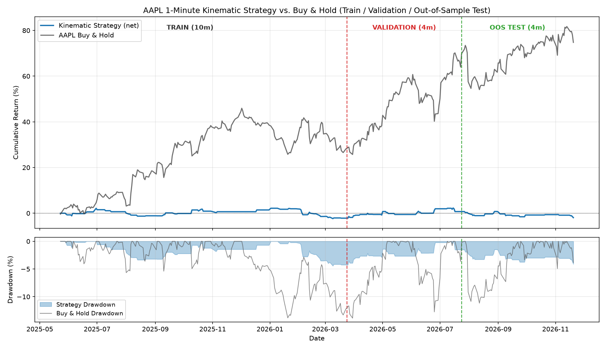
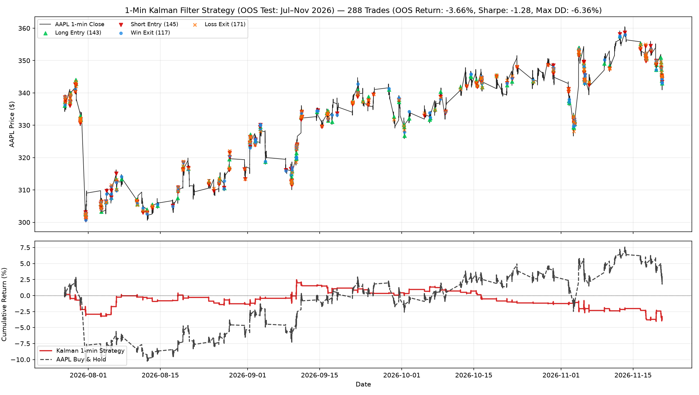
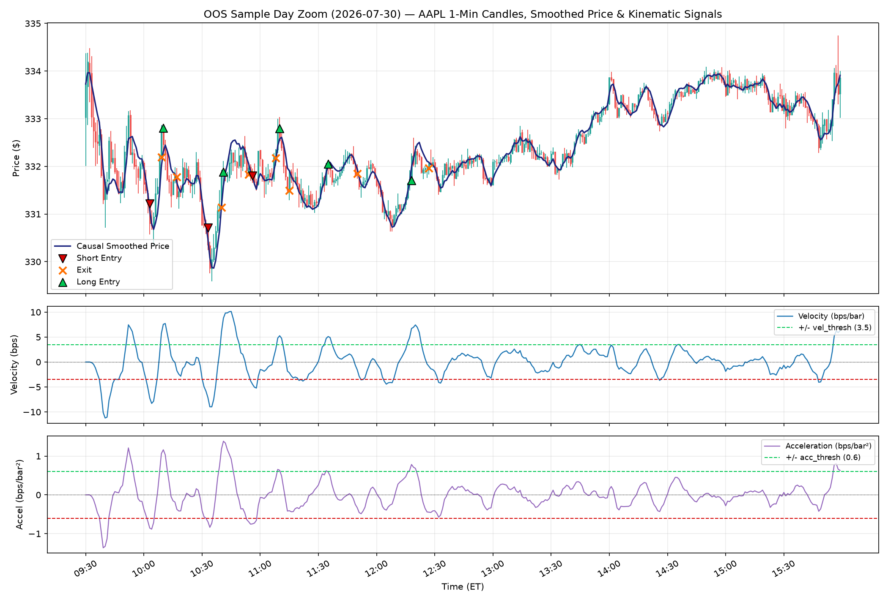
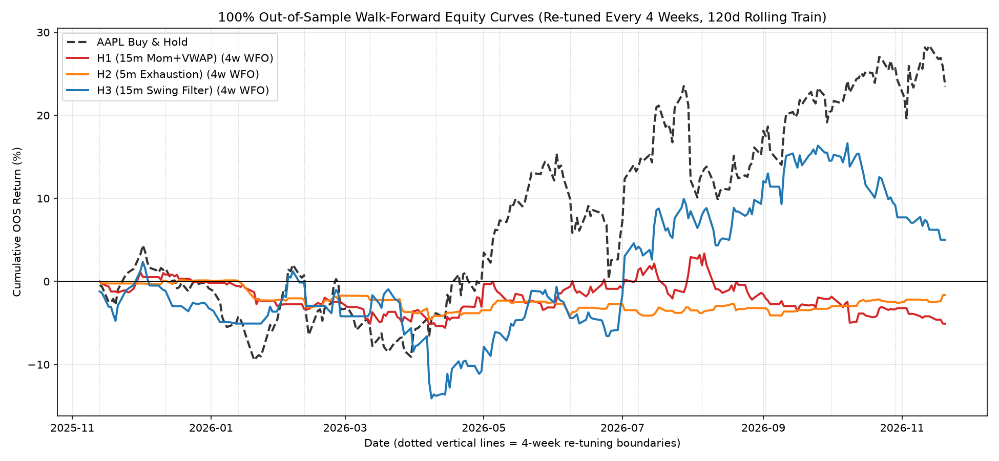
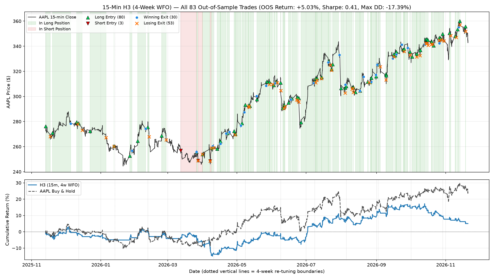
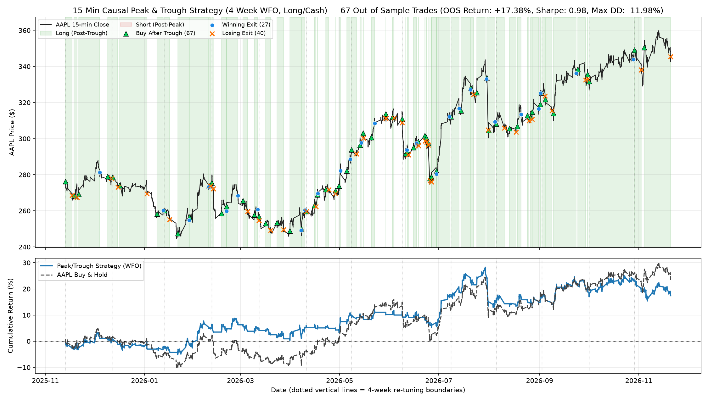
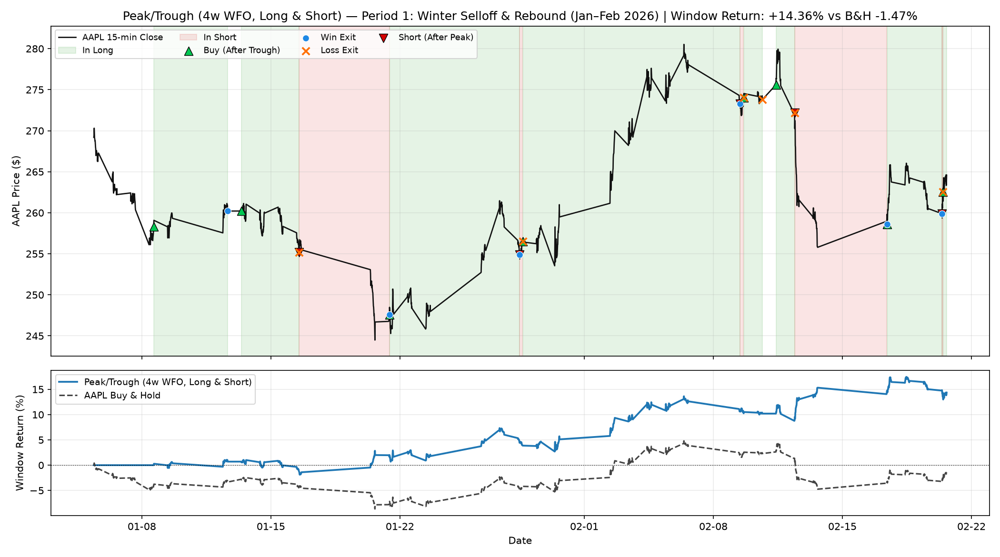
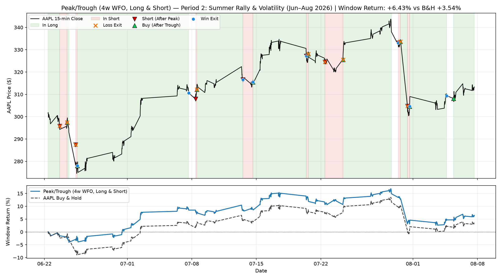
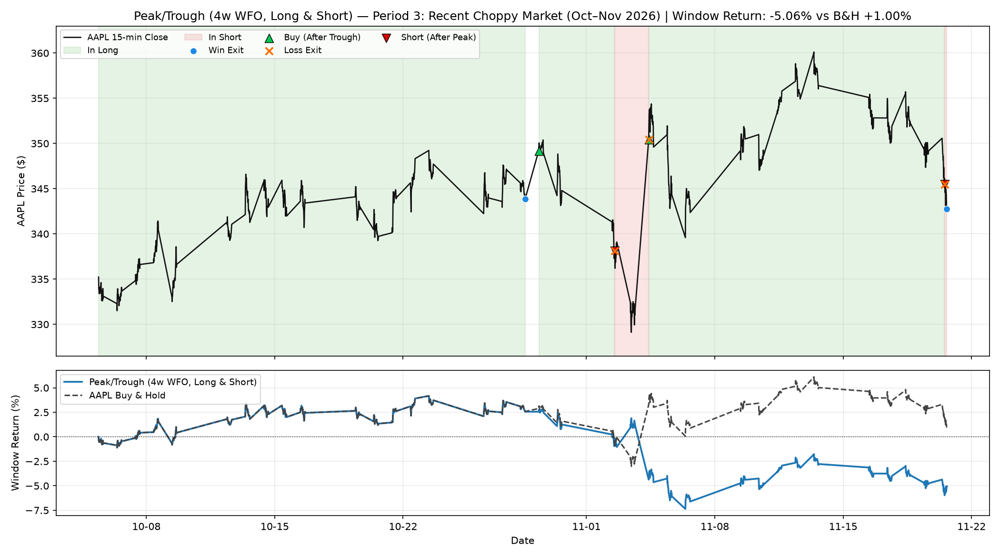
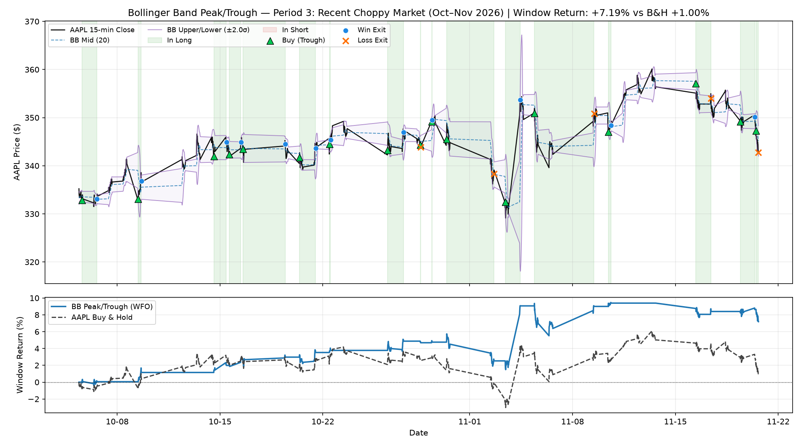

# AAPL 1-Minute Kinematic (Velocity & Acceleration) Strategy — Backtest Report

## 1. Executive Summary & Verdict
**Verdict:** **No Durable Positive Edge at 1-Minute Granularity After Realistic Friction**

- **Dataset:** 1.5 years of split-adjusted AAPL 1-minute SIP bars (`data/aapl_1min_18m.parquet`), RTH (`09:30–15:59 ET`) baseline with zero lookahead (signals at bar $t$ close execute at bar $t+1$ open).
- **Chronological Splits:** Train `2025-05-23 to 2026-03-24 (209d)` | Validation `2026-03-25 to 2026-07-24 (84d)` | Out-of-Sample Test `2026-07-27 to 2026-11-20 (84d)`.
- **Baseline Friction:** `1.50 bps/side` (`3.00 bps` round-trip, ~$0.033/share per side).
- **Selected Most-Stable Parameters (from Validation stability check):**
  - Smoother: `linreg` (`smooth_window=60`, `vel_lookback=3`, `reset_daily=True`)
  - Entry/Exit: `vel_thresh=3.5 bps/bar`, `acc_thresh=0.6 bps/bar²`, `exit_mode=vel_cross`, `min_atr_bps=0.0`, `SL=40.0 bps`, `TP=80.0 bps`, `flatten_eod=True`.

---

## 2. Performance Table (Train vs. Validation vs. Out-of-Sample Test)

| Split | Strategy Return | AAPL Buy & Hold | Ann. Sharpe | Max Drawdown | Win Rate | Profit Factor | Avg Trade | Trades | % of B&H | % of Oracle (0.25% Swings) |
|---|---:|---:|---:|---:|---:|---:|---:|---:|---:|---:|
| Train (10m) | -2.17% | +28.37% | -0.55 | -5.03% | 32.9% | 0.87 | -2.79 bps | 76 | -7.6% | -0.00% |
| Validation (4m) | +2.95% | +31.08% | 1.53 | -1.98% | 46.5% | 1.40 | +6.89 bps | 43 | 9.5% | 0.00% |
| **OOS Test (4m)** | -2.64% | +2.32% | -2.18 | -3.06% | 35.3% | 0.65 | -7.77 bps | 34 | -113.9% | -0.00% |

*Note:* Theoretical Oracle Ceiling (non-causal ZigZag capturing all $\ge 0.25\%$ swings long & short after identical 1.5 bps/side costs): Train `453,059,794.5%` (2,674 swings), Validation `122,997.8%` (1,174 swings), OOS Test `69,543.5%` (1,057 swings). OOS Buy & Hold Sharpe: `0.33`, Max DD: `-12.90%`.

---

## 3. Causal Smoother Comparison (Train Set Best per Smoother)

| Smoother | Best Window | Best Vel Lookback | Best Train Return | Best Train Sharpe | Trades | Median Grid Sharpe |
|---|---:|---:|---:|---:|---:|---:|
| `ema` | 60 | 3 | +2.56% | 0.47 | 51 | -5.34 |
| `dema` | 60 | 3 | +2.01% | 0.42 | 76 | -9.41 |
| `linreg` | 60 | 3 | -1.71% | -0.25 | 173 | -11.71 |
| `savgol` | 60 | 3 | -11.89% | -1.85 | 498 | -17.32 |
| `kalman` | 60 | 1 | -27.50% | -4.51 | 779 | -15.86 |

---

## 4. Parameter Stability Analysis (±10% & ±20% Perturbations on Validation)

- **Center Validation Sharpe:** `1.53`
- **Neighborhood Mean Sharpe (5×5 grid):** `0.52` (std `1.11`, min `-1.49`)
- **Neighborhood Mean Return:** `+1.20%` (`68%` of perturbed neighbors profitable)

---

## 5. Visualizations

### Equity Curve vs. AAPL Buy & Hold

### Out-of-Sample 1-Day Zoom (Candlesticks, Smoothed Price, Velocity & Acceleration)

---

## 6. Execution Friction, Session & Regime Diagnostics

### Execution Friction Sensitivity (Selected Parameters)

| Cost (bps/side) | Train Return | Val Return | OOS Test Return | OOS Sharpe | OOS Avg Trade |
|---:|---:|---:|---:|---:|---:|
| 0.0 | +0.09% | +4.29% | -1.64% | -1.39 | -4.77 bps |
| 0.5 | -0.67% | +3.84% | -1.97% | -1.66 | -5.77 bps |
| 1.0 | -1.42% | +3.40% | -2.31% | -1.92 | -6.77 bps |
| 1.5 | -2.17% | +2.95% | -2.64% | -2.18 | -7.77 bps |
| 2.0 | -2.91% | +2.51% | -2.97% | -2.42 | -8.77 bps |

### Session Comparison (OOS Test Period, Selected Parameters)

| Session Variant | OOS Return | OOS Sharpe | OOS Max DD | OOS Trades | Avg Trade |
|---|---:|---:|---:|---:|---:|
| RTH Intraday (flatten 15:55) | -2.64% | -2.18 | -3.06% | 34 | -7.77 bps |
| RTH Hold Overnight | -3.28% | -1.62 | -4.24% | 51 | -6.43 bps |
| Extended Hours (04:00-20:00, flatten off) | -11.11% | -3.12 | -11.35% | 137 | -8.48 bps |

### Trade Performance by Volatility Regime (Full Period, Entry ATR Tertiles)

| Volatility Regime | Trades | Win Rate | Avg Net Trade (bps) | Sum Net Return |
|---|---:|---:|---:|---:|
| Low Vol (<12.6 bps) | 51 | 31.4% | -7.68 bps | -3.92% |
| Mid Vol (12.6-16.2 bps) | 51 | 49.0% | +7.89 bps | +4.02% |
| High Vol (>16.2 bps) | 51 | 31.4% | -3.74 bps | -1.91% |

---

## 7. Initial Kalman Filter Trade Visualization

Even the best-ranked 1-minute Constant-Acceleration Kalman Filter config (`smooth_window=60`, `vel_lookback=1`, `vel_thresh=3.5`, `acc_thresh=0.6`, `min_atr_bps=6.0`, `exit_mode=vel_cross`) lost `-3.66%` OOS (`Sharpe -1.28`, `288` trades, `40.6%` win rate). In the 1-day zoom below, you can see it repeatedly buying at the exact top of 5-minute intraday spikes and shorting at the exact bottom of V-reversals:

---

## 8. Follow-Up Experiments: Higher Timeframes, Walk-Forward, VWAP & Peak/Trough Reversals

All follow-up strategies used the exact same 18-month AAPL RTH dataset, `1.5 bps/side` (`3.0 bps` round-trip) friction, and zero lookahead (bar $t$ signal executes at bar $t+1$ open).

### A. Higher-Timeframe & Mean-Reversion Exploration (`src/explore_edge.py`)
Static split (selected on Train + Validation, evaluated once on untouched OOS Test):

| Hypothesis | Timeframe & Logic | Train (10m) | Val (4m) | OOS Test (4m) | OOS Sharpe | OOS Max DD |
|---|---|---:|---:|---:|---:|---:|
| **Baseline** | 1m `linreg` momentum (intraday) | -2.17% | +2.95% | -2.64% | -2.18 | -3.06% |
| **H1: Momentum + VWAP** | 15m ATR-norm vel/accel + VWAP (L/S) | +4.51% | +4.36% | -9.60% | -3.70 | -13.83% |
| **H2: Exhaustion Reversion** | 5m fade extreme vel when accel flips | +2.75% | +0.43% | -2.78% | -3.23 | -3.09% |
| **H3: Multi-Day Swing Filter** | 15m (`sw=120`, ~4.6d) Long/Cash | +29.79% | +17.73% | -1.62% | -0.23 | -8.88% |
| *Benchmark* | *AAPL Buy & Hold* | *+28.37%* | *+31.08%* | *+2.32%* | *0.33* | *-12.90%* |

### B. Rolling Walk-Forward Optimization (`src/walk_forward.py`)
Rolling 120-day Train window, re-tuned every 4 weeks (13 folds) or 2 weeks (26 folds), stitched into ~12 months of **100% out-of-sample** trading:

| Re-tune Cycle | Strategy | OOS Return | AAPL Buy & Hold | OOS Sharpe | Max DD | Winning Folds | Trades |
|---|---|---:|---:|---:|---:|---:|---:|
| **4-Week** | H1 (15m Mom+VWAP) | -5.08% | +23.48% | -0.48 | -8.82% | 38% | 242 |
| | H2 (5m Exhaustion) | -1.64% | +23.48% | -0.36 | -4.95% | 62% | 150 |
| | **H3 (15m Swing Filter)** | **+5.03%** | +23.48% | **0.41** | -17.39% | 54% | 83 |
| **2-Week** | H1 (15m Mom+VWAP) | -5.82% | +20.60% | -0.58 | -8.20% | 42% | 209 |
| | H2 (5m Exhaustion) | -3.24% | +20.60% | -0.73 | -6.88% | 46% | 159 |
| | **H3 (15m Swing Filter)** | **+5.99%** | +20.60% | **0.46** | -17.19% | 50% | 91 |

### C. `close` vs. `vwap` Signal Input A/B Test (`src/features.py`)
- **1-min Baseline OOS:** `close` (`-2.64%`, Sharpe `-2.18`) vs. `vwap` (`-1.75%`, Sharpe `-1.31`) — slight noise reduction, still negative.
- **15-min H3 (4w WFO):** `close` (`+5.03%`, Sharpe `0.41`) vs. `vwap` (`-1.84%`, Sharpe `0.06`) — 15-min bar VWAP adds ~7.5 min of extra lag vs. bar `close`, hurting swing timing.

### D. Causal Peak & Trough Reversal vs. Bollinger Band Re-entry (15-min, 4-Week WFO)
Tested in `src/peak_trough_strategy.py` (confirm trough after `rebound_pct` bounce, confirm peak after `pullback_pct` drop) and `src/bollinger_peak_trough.py` (confirm trough/peak on Bollinger Band re-entry or BB-width reversal):

| Strategy (15-min AAPL, 4-Week WFO) | OOS Return | AAPL Buy & Hold | OOS Sharpe | Max DD | Winning Folds | Trades |
|---|---:|---:|---:|---:|---:|---:|
| **Fixed-% Peak/Trough (Long & Short)** | **+24.52%** | +23.48% | **1.11** | **-12.44%** | 62% (8/13) | 90 |
| **Fixed-% Peak/Trough (Long/Cash)** | **+17.38%** | +23.48% | **0.98** | **-11.98%** | **77%** (10/13) | 67 |
| **BB Band Re-entry (Long/Cash)** | **+12.94%** | +23.48% | **0.77** | **-12.91%** | 54% (7/13) | 106 |
| BB Band Re-entry (Long/Short) | +6.06% | +23.48% | 0.43 | -12.91% | 46% (6/13) | 113 |
| BB Width Reversal (Long/Cash) | -6.76% | +23.48% | -0.18 | -17.70% | 46% (6/13) | 147 |

**Regime Complementarity Across 3 Zoomed ~6-Week Windows:**

| Zoomed Period | AAPL Buy & Hold | Fixed-% Peak/Trough (L/S) | BB Band Re-entry (L/C) |
|---|---:|---:|---:|
| Period 1: Jan–Feb 2026 (Selloff & Rebound) | -1.47% | **+14.36%** | -1.43% |
| Period 2: Jun–Aug 2026 (Summer Rally) | +3.54% | **+6.43%** | -8.79% |
| Period 3: Oct–Nov 2026 (Recent Chop) | +1.00% | -5.06% | **+7.19%** |

---

## 9. Failure Modes & TODOs (On Hold for Next Iteration)

### Where the Best Strategy (Fixed-% Peak/Trough 4w WFO) Still Fails
1. **Sideways sawtooth chop** (e.g., Oct–Nov 2026: `-5.06%`).
2. **Overnight event gaps** (e.g., Nov 3–4 `$331 → $350` overnight gap while short).
3. **Stale parameters after abrupt regime flips** (e.g., WFO selecting `pullback=3%` + `smooth_window=10` from a prior trending window right before a choppy month).

### TODOs for Next Phase
- [ ] **Chop / Regime Detection & Strategy Switching:** Test causal regime filters (Kaufman Efficiency Ratio, ADX) to pause trading during sideways chop—or dynamically switch from **Fixed-% Peak/Trough** (trending regimes) to **Bollinger Band Re-entry** (choppy regimes, where it earned `+7.19%` vs `+1.00%` B&H).
- [ ] **Multi-Timescale Directional Gating:** Use a slow timeframe (daily or 4-hour trend) to gate trade direction (e.g., allow Longs only in daily uptrends, blocking counter-trend shorts like Nov 2–4) while timing entries/exits on 15-min bars.
- [ ] **Earnings / Event Gap Protection:** Flatten or avoid shorting across scheduled earnings releases and FOMC events.
- [ ] **Cross-Ticker & Multi-Year Validation:** Validate the winning Peak/Trough WFO pipeline across `SPY`, `QQQ`, `MSFT`, `NVDA`, and multi-year bear/bull/sideways history (e.g., 2022 bear market + 2023–2026) before considering paper trading.
- [ ] **Volume & Relative-to-QQQ Signals:** Test relative-volume confirmation (`min_rel_vol`) and AAPL-vs-QQQ spread mean reversion.

